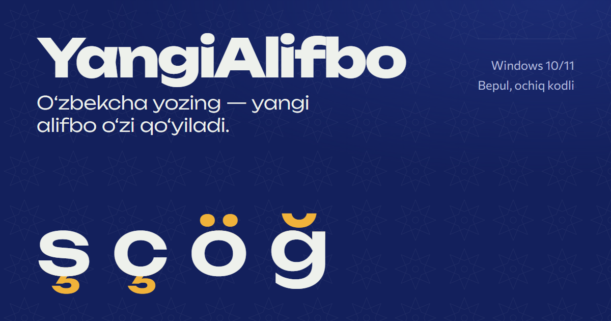

# YangiAlifbo

[](https://bilolbekyoldoshxojayev.github.io/yangicha-alifbo/)
[](https://github.com/BilolbekYoldoshxojayev/yangicha-alifbo/releases/latest)
[](LICENSE)



**YangiAlifbo** — Windows uchun tizim patnisida ishlaydigan dastur. Word, Telegram, brauzer yoki bloknotda odatdagidek eski lotin imlosida yozasiz; so‘z tugashi bilan (probel, Enter, tinish belgisi) u yangi alifboga o‘giriladi:

| Eski | Yangi | Misol |
|---|---|---|
| `sh` | `ş` | shahar → şahar |
| `ch` | `ç` | choyxona → çoyxona |
| `o‘` / `o'` / `oʻ` | `ö` | o‘rtoq → örtoq |
| `g‘` / `g'` / `gʻ` | `ğ` | g‘alaba → ğalaba |

Sayt va brauzerdagi demo: **https://bilolbekyoldoshxojayev.github.io/yangicha-alifbo/**

## O‘rnatish

1. [Relizlar](https://github.com/BilolbekYoldoshxojayev/yangicha-alifbo/releases/latest) sahifasidan `YangiAlifbo.exe` ni yuklab oling (Windows 10/11, x64).
2. Ishga tushiring. O‘rnatuvchi yo‘q — .NET 10 runtime fayl ichiga joylangan (self-contained, single-file).
3. Odatdagidek yozing.

Fayl raqamli imzolanmagan, shuning uchun Windows SmartScreen ogohlantirish ko‘rsatishi mumkin. Faylni faqat rasmiy relizdan yuklang va SHA-256 qiymatini relizdagi bilan solishtiring:

```powershell
Get-FileHash .\YangiAlifbo.exe -Algorithm SHA256
```

### macOS (v2.1.0 dan)

```bash
curl -fsSL https://github.com/BilolbekYoldoshxojayev/yangicha-alifbo/releases/latest/download/install-mac.sh | sh
```

macOS 12+, Apple Silicon va Intel. Birinchi ishga tushganda **Tizim sozlamalari → Maxfiylik va xavfsizlik → Maxsus imkoniyatlar → YangiAlifbo** ni yoqing. Mac’da dastur Windows’dagidek ishlaydi (macOS boshqa dasturlardagi tugmalarni kuzatishga foydalanuvchi ruxsati bilan imkon beradi): so‘z probeldan keyin yangi alifboga o‘tadi; parol maydonlarida macOS o‘zi to‘sadi, terminal va kod muharrirlari o‘tkazib yuboriladi. Sozlamalar menyu satridagi “Ş” belgisida; dastur o‘zi yangilanadi. Ilova Apple tomonidan imzolanmagan (o‘z sertifikatimiz bilan imzolangan), shuning uchun yuqoridagi buyruq bilan o‘rnatish tavsiya etiladi. O‘chirish: `… | sh -s -- --uninstall`.

### Linux (v2.0.0 dan)

```bash
curl -fsSL https://github.com/BilolbekYoldoshxojayev/yangicha-alifbo/releases/latest/download/install.sh | sh
```

So‘ng: **Sozlamalar → Klaviatura → Kiritish manbalari → + → O‘zbek → YangiAlifbo** (KDE va boshqalarda: `ibus-setup` → Input Method → Add). Super+Space bilan almashtiriladi. O‘chirish: `… | sh -s -- --uninstall`.

Linux’da Windows’dagidek ishlamaydi, chunki Wayland (va Linux xavfsizlik modeli) bir dasturga boshqa dasturlardagi tugmalarni kuzatish va o‘rniga tugma bosishga ruxsat bermaydi — bu aynan keylogger qiladigan ish. Shuning uchun YangiAlifbo IBus kiritish usuli sifatida ishlaydi: yozilayotgan so‘z tagiga chiziladi, probel yoki tinish belgisi bosilganda yangi alifboda qo‘yiladi. Dvigatel (lug‘at, morfologiya, neyron model) Windows’dagi bilan bir xil: 1 230 222 ta so‘zda natijalar baytma-bayt mos keladi. Parol maydonlari va terminallarda konvertatsiya o‘chadi. Talab: IBus va Python GObject (`python3-gi`); o‘rnatuvchi yo‘qlarini aytadi.

### Android

1. [Relizlar](https://github.com/BilolbekYoldoshxojayev/yangicha-alifbo/releases/latest) sahifasidan `yangialifbo-android.apk` ni yuklab oling va o‘rnating (Android 8.0+). Brauzer yoki fayllar ilovasiga «noma’lum manbalardan o‘rnatish» ruxsatini bering.
2. YangiAlifbo ilovasini oching va ikki usuldan birini tanlang:
   - **A. Istalgan klaviatura bilan (Samsung, Gboard…).** Bosh ekrandagi «Yoqish» tugmasini bosing va ro‘yxatdan YangiAlifbo’ni yoqing (ilova qadamlarni o‘zi ko‘rsatadi). Klaviaturani almashtirish shart emas: odatdagidek yozasiz, probel yoki tinish belgisidan keyin so‘z yangi alifboga almashtiriladi. Android sideload qilingan ilova uchun maxsus imkoniyatni o‘chirib qo‘ygan bo‘lsa: Sozlamalar → Ilovalar → YangiAlifbo → ⋮ → «Cheklangan sozlamalarga ruxsat berish».
   - **B. YangiAlifbo klaviaturasi.** **1. Klaviaturani yoqish**, so‘ng **2. Klaviaturani tanlash**. So‘z yozilayotganda tagiga chizilgan holda turadi; o‘tkazishdan keyin darhol **⌫** bossangiz, so‘z yozilganidek qaytadi.
3. Odatdagidek eski imloda yozing: so‘z probel, tinish belgisi (B usulida Enter ham) bilan tugagach, u yangi alifboga o‘tadi (`shahar` → `şahar`).

Android’da boshqa ilovalardagi tugmalarni to‘g‘ridan-to‘g‘ri kuzatish mumkin emas. A usuli Maxsus imkoniyatlar xizmati orqali ishlaydi: u matn maydonidagi o‘zgarishni ko‘radi va tugagan so‘zni almashtiradi. Faqat oddiy matn maydonlari o‘zgaradi (parol, e-pochta, URL va raqam maydonlari emas); matn saqlanmaydi va yuborilmaydi. Cheklov: bu usulda so‘zni almashtirish klaviatura so‘zni kiritib bo‘lgandan keyin bo‘ladi, shuning uchun ba’zi ilovalarda matn bir lahza o‘zgarib ko‘rinishi yoki kursor sakrashi mumkin, va ⌫ bilan qaytarish ishlamaydi (so‘zni qora ro‘yxatga qo‘shing). B usuli bunday emas, lekin klaviaturani almashtirishni talab qiladi. Dvigatel — C# dvigatelning Kotlin’dagi nusxasi (`android/engine`); CI har safar u Windows’dagi bilan 1 230 222 so‘zda baytma-bayt bir xil natija berishini tekshiradi. Ilovada internet ruxsati yo‘q. Sozlamalar: yoqish/o‘chirish, chat yozuvi, neyron model, qat’iy/agressiv rejim, oq va qora ro‘yxat. B usulida `s`, `c`, `o`, `g` va `'` tugmalarini uzoq bosib, `ş ç ö ğ ʼ` ni to‘g‘ridan-to‘g‘ri yozish mumkin.

APK’ni o‘zingiz yig‘ish: `cd android && ./gradlew :app:assembleRelease` (JDK 17+, Android SDK 37). GitHub’da reliz avtomatik: `git tag android-v1.0.0 && git push origin android-v1.0.0` (tag `appVersion` bilan bir xil bo‘lishi kerak) — Actions APK’ni yig‘adi va `yangialifbo-android.apk` bilan relizni o‘zi yaratadi. Reliz imzolanishi uchun `ANDROID_KEYSTORE_BASE64`, `ANDROID_KEYSTORE_PASSWORD`, `ANDROID_KEY_ALIAS`, `ANDROID_KEY_PASSWORD` secret’larini qo‘shing, aks holda APK vaqtinchalik debug kalit bilan imzolanadi va keyingi relizni ustiga o‘rnatib bo‘lmaydi.

## Foydalanish

- **`Ctrl + Shift + U`** — konvertorni yoqish / o‘chirish.
- **Boshqaruv paneli:** patnisdagi belgini bosing. Panel saytdagi dizaynda (WebView2): jonli sinash maydoni to‘liq dvigatel bilan, sozlamalar, lug‘at statistikasi. WebView2 runtime bo‘lmagan kompyuterda oddiy oyna ochiladi.
- Patnisdagi belgi: yashil — faol, kulrang — to‘xtatilgan. O‘ng tugma menyusida: yoqish/o‘chirish, rejim (Qat’iy / Agressiv), oq va qora ro‘yxatni tahrirlash, Windows bilan birga ishga tushirish, dastur haqida, chiqish.
- **Avtomatik yangilanish** (v1.6.0 dan): har 6 soatda so‘nggi reliz tekshiriladi; yangisi topilsa yuklab olinadi, GitHub e’lon qilgan SHA-256 bilan solishtiriladi, yangi `.exe` o‘rnatuvchi sifatida ishga tushadi, eski jarayon yopilgach faylni almashtiradi va dastur qayta ishga tushib, boshqaruv panelida nima o‘zgarganini ko‘rsatadi. Boshqaruv panelidagi “Yangilanish” bo‘limida o‘chirish yoki qo‘lda tekshirish mumkin. `.exe` joylashgan papkaga yozish huquqi bo‘lishi kerak.
- **Avtomatik ishga tushirish** sukut bo‘yicha yoqilgan (v1.1.0 dan). Menyudan o‘chirsangiz, tanlov saqlanadi.
- **Qat’iy rejim** (standart): faqat lug‘at yoki morfologiya tasdiqlagan so‘zlar o‘zgaradi. **Agressiv rejim**: filtrdan o‘tgan har qanday so‘z o‘zgaradi.
- Shaxsiy ro‘yxatlar: `%AppData%\YangiAlifbo\user_whitelist.txt` va `user_blacklist.txt` (har qatorda bitta so‘z, saqlanganda qayta yuklanadi).

## Qanday ishlaydi

1. **Naqsh.** So‘zda `sh`, `ch`, `o‘`, `g‘` bo‘lmasa, unga tegilmaydi. Tutuq belgisi ajratgan `s'h` / `c'h` (Is’hoq, mus’haf, as’hob) hisobga olinmaydi.
2. **Filtr.** 112 447 ta xorijiy so‘z (inglizcha, ispancha, fransuzcha va dasturlash so‘zlari: `show`, `push`, `switch`, `catch`…) o‘zgartirilmaydi. Ro‘yxat LibreOffice imlo lug‘atlaridan yig‘ilgan va unda birorta o‘zbekcha so‘z yo‘q ([`tools/dict/`](tools/dict/)).
3. **Lug‘at.** 959 740 yozuvli o‘zbek lug‘ati (so‘z va o‘zaklar, eski va yangi imloda), shu jumladan O‘zbek Vikipediyasidan olingan 11 619 ta so‘z. Morfologiya o‘zi topa oladigan shakllar faylda saqlanmaydi, shuning uchun lug‘at hajmi kichraydi.
4. **Morfologiya.** 400+ qo‘shimchani (`-lar`, `-imiz`, `-dan`, `-gan`, `-yapti`…) va nisbat qo‘shimchalarini (`-n`, `-il`, `-t`, `-tir`) ajratib, o‘zak qidiriladi.
5. **Neyron model** (v1.8.0 dan). Lug‘at va morfologiya tanimagan so‘zni 5 ta kichik belgi darajasidagi CNN baholaydi; so‘z faqat o‘zbek lotin harflaridan iborat bo‘lsa, uning barcha 3 harfli birikmalari o‘zbek so‘zlarida uchrasa va eng ehtiyotkor model ham chegaradan yuqori ball bersa o‘giriladi. Chegara 16 714 ta xorijiy so‘zning birortasi ham o‘tmaydigan qilib tanlangan. Chat normalizatori o‘zgartirgan shakllar modelga berilmaydi. Batafsil: [`tools/neural/`](tools/neural/README.md). Sozlamalarda yoki patnis menyusida o‘chiriladi.

Katta-kichik harf saqlanadi (`Shahar → Şahar`, `SHAHAR → ŞAHAR`), raqamli tartib ham ishlaydi (`5-chi → 5-çi`), apostrofning 9 xil ko‘rinishi (`' ‘ ’ ʻ ʼ ` ´ ‛ ′`) taniladi.

**Xavfsizlik:** terminal va IDE jarayonlarida (cmd, PowerShell, Windows Terminal, VS Code, Visual Studio, Git Bash, WSL va b.) va Windows parol maydoni deb belgilagan joylarda (ES_PASSWORD, UI Automation IsPassword) konvertatsiya o‘chadi. `SendInput` orqali kiritilgan belgilar `dwExtraInfo = 0x59414E47` bilan belgilanadi, shuning uchun hook o‘z kiritishini qayta ishlamaydi. Ilova internetga faqat yangilanishni tekshirish uchun GitHub Releases API’ga murojaat qiladi; yozilgan matn hech qayerga yuborilmaydi.

**Ma’lum cheklovlar:**
- Administrator huquqi bilan ishlayotgan dasturlarda ishlamaydi (Windows UIPI chegarasi).
- Qat’iy rejimda lug‘atda yo‘q so‘zlar o‘zgarmaydi. v1.5.0 da viloyat, shahar, tuman va keng tarqalgan ismlar qo‘shildi; yo‘q bo‘lganlarini oq ro‘yxatga qo‘shing yoki xato sifatida xabar bering.

## Loyihani yig‘ish

Talablar: Windows 10/11, [.NET 10 SDK](https://dotnet.microsoft.com/download).

```powershell
dotnet test tests/YangiAlifbo.Tests.csproj -c Release        # 558 ta unit test
dotnet test e2e_tests/YangiAlifbo.E2ETests.csproj -c Release  # 270 ta E2E test
.\publish.ps1                                                # testlar + publish/YangiAlifbo.exe
```

Tuzilma:

```
src/Core/       UzbekPhonetics.cs (harf qoidalari), LanguageDetector.cs (filtr, lug‘at, morfologiya)
src/Core/Dictionaries/   english_reject.txt, uzbek_words.txt, uzwords_raw.txt
src/Win32/      klaviatura/sichqoncha hook’lari, fokus va parol maydonini aniqlash, SendInput
src/UI/         tizim patnisi, menyu, Ctrl+Shift+U
tests/, e2e_tests/       MSTest
docs/           GitHub Pages sayti (statik, yig‘ish bosqichi yo‘q)
```

`docs/assets/js/engine.js` — `UzbekPhonetics.cs` ning brauzerdagi nusxasi (demo uchun). U C# dvigatel bilan 5 012 ta so‘zda bir xil natija berishi tekshirilgan. Brauzer demosida lug‘at va morfologiya yo‘q: u harf qoidalari va filtr bilan ishlaydi.

## Hissa qo‘shish

- **Xato:** [Issues](https://github.com/BilolbekYoldoshxojayev/yangicha-alifbo/issues/new) da so‘z, kutilgan natija va qaysi dasturda yozganingizni yozing.
- **Kod:** repozitoriyani fork qiling, o‘zgartiring, `dotnet test` ikkala loyihada o‘tishini tekshiring va pull request yuboring. Lug‘atga tegishli o‘zgarishlarda yangi so‘zlar uchun test qo‘shing.

## Manbalar

O‘zbek lug‘ati [anvarnarz/uzwords](https://github.com/anvarnarz/uzwords) ro‘yxati asosida `build_dictionaries.py` bilan tuzilgan.

## Litsenziya

[MIT](LICENSE) © 2026 Bilolbek Yoldoshxojayev
